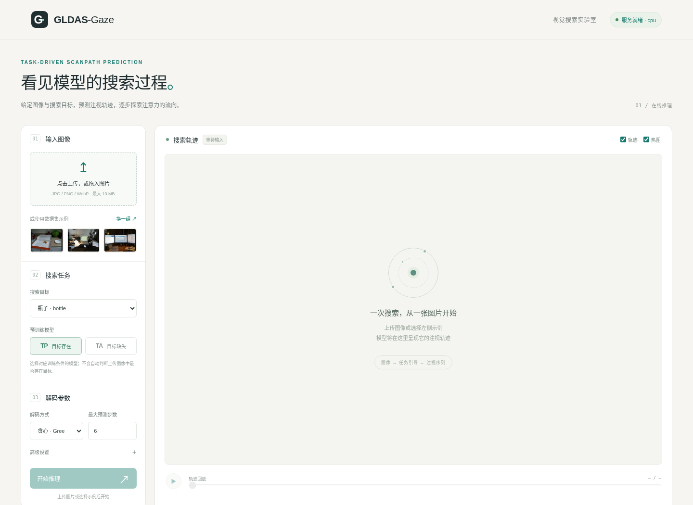

# Task-Driven Scanpath Prediction: Reproduction Guide

Given an image and a search target, predict a sequence of fixation locations
and when to stop searching. This repository provides environment setup,
training, dataset evaluation, single-image inference, and a local web demo.
Both target-present (TP) and target-absent (TA) conditions are supported on
COCO-Search18.

## 1. Environment Setup

Run all commands from the repository root unless stated otherwise.
The suggested environment uses Python 3.9, PyTorch 1.13.1,
torchvision 0.14.1, and NumPy 1.x.

```bash
conda create -n scanpath python=3.9 -y
conda activate scanpath
cd /path/to/repository

# Choose a CUDA version compatible with your driver; CUDA 11.7 is shown here.
pip install torch==1.13.1+cu117 torchvision==0.14.1+cu117 \
  --extra-index-url https://download.pytorch.org/whl/cu117
pip install 'git+https://github.com/facebookresearch/detectron2.git'
pip install -r requirements.txt
```

The current attention module uses a PyTorch implementation, so the default
workflow does not require compiling the CUDA extension. To build the extension
separately, first install a CUDA toolkit compatible with PyTorch, then run:

```bash
cd gldas_gaze/pixel_decoder/ops
sh make.sh
cd ../../..
```

## 2. Prepare Model Weights and Data

### Model Weights

Download: [Pretrained models (Google Drive)](https://drive.google.com/drive/folders/13VYpirKeGfPPlCfmI3z_y3VCnf1UtT49?usp=sharing).

Model weights are distributed separately from the Git repository.
Place the required files in the following directory before running:

```text
pretrained_models/
├── M2F_R50.pkl
├── M2F_R50_MSDeformAttnPixelDecoder.pkl
├── TP.pt
└── TA.pt
```

- Training requires both `M2F_R50*.pkl` files to initialize the backbone
  and pixel decoder.
- Evaluation or inference with a pretrained model also requires `TP.pt`
  or `TA.pt`, matching the model's training condition.
- Only the `.pt` file for the condition being used is required.
- `configs/resnet50.yaml` uses the relative backbone path
  `pretrained_models/M2F_R50.pkl` by default. The pixel decoder weights
  are loaded from the same directory.

### COCO-Search18 Data

Download: [Processed dataset (Google Drive)](https://drive.google.com/drive/folders/158FUAAiwMwEbSOULvLGn7SIyTirU8Eg6?usp=sharing).

The dataset source is [COCO-Search18](https://github.com/cvlab-stonybrook/COCO-Search18).
Training and dataset evaluation require images, fixation annotations,
and preprocessing files in the format expected by the code. Downloading
only the original images is insufficient for the full workflow.
Use the following directory structure:

```text
dataset_root/
├── images/
├── imagesTA/
├── semantic_seq_full/
│   └── segmentation_maps/
├── coco_search_fixations_512x320_on_target_allvalid.json
├── coco_freeview_fixations_512x320.json
├── bbox_annos.npy
├── clusters.npy
├── all_task_ids.npy
└── scene_label_dict.npy
```

`coco_freeview_fixations_512x320.json` is used for free-viewing pretraining.
Pass the actual dataset directory through `--dataset-root`.
Single-image inference on your own images does not require the full dataset.

## 3. Single-Image Inference and Web Demo

After installing dependencies and preparing model weights, use your own
image to check inference.



The web interface supports image uploads, search target selection,
scanpath playback, and step-by-step heatmaps.

### Command-Line Inference

```bash
python tools/infer_image.py \
  --image /path/to/image.jpg \
  --task bottle \
  --condition TP \
  --device auto \
  --output-dir outputs
```

The outputs are `outputs/scanpath.png` and `outputs/scanpath.json`.
The JSON file contains coordinates in the model's 512 x 320 image space,
stopping probabilities, per-step fixation coordinates, and inference settings.

- `--task` accepts one of the 18 COCO-Search18 category names. Quote names
  containing spaces, for example `--task "potted plant"`.
- `--condition TP` or `TA` selects weights for the corresponding training
  condition. It does not detect whether the target exists in the input image.
- `--device auto` selects CUDA when available and CPU otherwise.
  You can also specify `cpu` or `cuda` directly.
- Greedy decoding is used by default. Use `--decoding sample --seed 42`
  for sampling with a fixed seed.
- TP allows up to 6 decoding steps and TA up to 10, in addition to the
  initial center fixation.
- Adjust the decoding limit and stopping threshold with `--max-steps`
  and `--stop-threshold`.

See `python tools/infer_image.py --help` for all options.

### Local Web Demo

```bash
./web_demo/start.sh --device auto
```

Open <http://127.0.0.1:8765> in a browser, upload a JPEG, PNG, or WebP image,
then select a search target and TP / TA condition to run inference.
The interface provides scanpath playback, step-by-step heatmaps,
and PNG / JSON export.

To use a specific Python environment:

```bash
GLDAS_PYTHON=/path/to/env/bin/python ./web_demo/start.sh \
  --device auto --port 8765 --dataset-root /path/to/dataset_root
```

The server listens on localhost by default. Models are loaded on the first
request and cached for later requests. Dataset examples require the dataset;
uploading your own images does not.
See the [web inference guide](web_demo/README.md) for options and API details.

## 4. Training

### Target-Present (TP)

```bash
python train.py \
  --hparams configs/coco_search18_dense_SSL_TP.json \
  --dataset-root /path/to/dataset_root \
  --gpu-id 0
```

### Target-Absent (TA)

```bash
python train.py \
  --hparams configs/coco_search18_dense_SSL_TA.json \
  --dataset-root /path/to/dataset_root \
  --gpu-id 0
```

Training settings are defined in the corresponding JSON configuration,
including batch size, data loader workers, training iterations,
learning rate, and checkpoint intervals. Adjust `Train.batch_size`
and `Train.n_workers` to match your GPU memory and CPU resources.

- Default TP output directory: `assets/GLDAS_TP/`.
- Default TA output directory: `assets/GLDAS_TA/`.
- Checkpoint filename: `ckp_<step>.pt`.
- Change `Train.log_dir` to use a different output directory.

## 5. Dataset Evaluation

Use a model configuration and checkpoint matching the evaluation condition.

```bash
# Evaluate a TP model under the TP condition.
python test_eval.py \
  --hparams configs/coco_search18_dense_SSL_TP.json \
  --dataset-root /path/to/dataset_root \
  --ckpt pretrained_models/TP.pt \
  --gpu-id 0 \
  --eval-mode greedy \
  --tap TP

# Evaluate a TA model under the TA condition.
python test_eval.py \
  --hparams configs/coco_search18_dense_SSL_TA.json \
  --dataset-root /path/to/dataset_root \
  --ckpt pretrained_models/TA.pt \
  --gpu-id 0 \
  --eval-mode greedy \
  --tap TA
```

- Metrics and prediction files are saved to `Train.log_dir` in the configuration.
- Use `--eval-mode sample` for sampling-based decoding.
- `--disable-saliency` skips cIG, cNSS, and cAUC computation.
- Step-by-step overlay images are disabled by default.
  Add `--save-overlays` to generate them.

### Cross-Condition Evaluation

Use `tools/cross_condition_eval.py` when the model's training condition
and the evaluation condition differ. `--model-hparams` defines the model
architecture; `--eval-hparams` defines the data and evaluation protocol.

```bash
# Evaluate a TP model under the TA condition.
python tools/cross_condition_eval.py \
  --model-hparams configs/coco_search18_dense_SSL_TP.json \
  --eval-hparams configs/coco_search18_dense_SSL_TA.json \
  --dataset-root /path/to/dataset_root \
  --ckpt pretrained_models/TP.pt \
  --tap TA \
  --gpu-id 0 \
  --disable-saliency
```

See the [cross-condition evaluation guide](docs/cross_condition_generalization.md)
for all four condition combinations, time-step embedding extension,
and output directory settings.

### Stopping Behavior Analysis

After evaluation produces `predictions_*.json`, compare the lengths
of predicted and human scanpaths:

```bash
python tools/analyze_stopping_behavior.py \
  --dataset-root /path/to/dataset_root \
  --pred-root assets/cross_condition_eval \
  --output-dir assets/stopping_analysis
```

The script generates `stopping_summary.csv`, `stopping_metrics.json`,
and `length_distribution_*.png`. These outputs report average scanpath length,
length MAE, signed length error, over-search and under-search rates,
and target-hit statistics for TP.

## 6. Repository Layout and Usage

- `train.py`: training entry point.
- `test_eval.py`: evaluation under the matching condition.
- `tools/`: single-image inference, cross-condition evaluation,
  and stopping behavior analysis.
- `configs/`: model, data, and training configurations.
- `web_demo/`: local web inference server.

Data, weights, build artifacts, and runtime outputs are excluded from version
control. Follow the applicable licenses of third-party datasets and components,
including COCO-Search18, Detectron2, and Deformable DETR.
