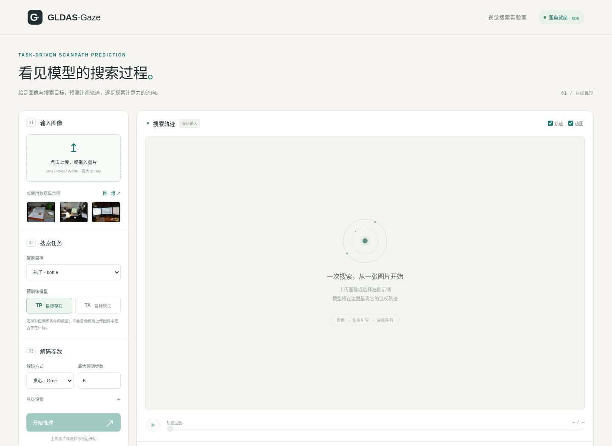

# GLDAS-Gaze

**Global-Local Dynamic Adaptive Synergy for Task-Driven Scanpath Prediction**

作者：Shangyu Zhou、Dongbo Zhang、Jianwu Fang、Yaonan Wang。

给定一张图像和搜索目标，模型预测逐步注视位置与停止时机。
本仓库提供训练、数据集评估、**单图命令行推理**和**本机网页演示**。



> 图：本机运行的网页界面。网页服务默认监听 `127.0.0.1`，
> 仓库本身不提供公开托管的在线服务。

## 快速开始：使用预训练模型

1. 按下方[环境配置](#environment-setup)安装依赖。
2. 从[预训练模型下载目录](https://drive.google.com/drive/folders/13VYpirKeGfPPlCfmI3z_y3VCnf1UtT49?usp=sharing)
   下载 `TP.pt`、`TA.pt`、`M2F_R50.pkl` 和
   `M2F_R50_MSDeformAttnPixelDecoder.pkl`，放入仓库根目录的
   `pretrained_models/`。只使用 TP 或 TA 时，可只下载对应的 `.pt`。
3. 在仓库根目录运行以下命令。自备图片推理不需要下载完整数据集。

```bash
# 单张图片：生成 outputs/scanpath.png 和 outputs/scanpath.json
python tools/infer_image.py \
  --image /path/to/image.jpg --task bottle --condition TP \
  --device auto --output-dir outputs

# 本机网页：浏览器打开 http://127.0.0.1:8765
./web_demo/start.sh --device auto
```

`--task` 取 COCO-Search18 的 18 个类别之一；含空格的类别使用引号，
例如 `--task "potted plant"`。`TP` / `TA` 是模型训练条件，
分别对应目标存在 / 缺失；模型不会自动判断图片中是否存在目标。
权重约 820 MB，存放在外部下载目录，未提交到 Git 仓库。
命令行参数见 `python tools/infer_image.py --help`，
网页细节见 [web_demo/README.md](web_demo/README.md)。

---

## Abstract

This repository provides the code for training and evaluating the GLDAS-Gaze model for task-driven scanpath prediction. The model uses a dual-stream (dorsal/ventral) architecture with cross-stream interaction and supports both Target-Present (TP) and Target-Absent (TA) evaluation on COCO-Search18.

---

## Environment Setup

### 1. Create conda environment

We use the conda environment named `gldas-gaze` (Python 3.9). Create and activate it:

```bash
conda create -n gldas-gaze python=3.9 -y
conda activate gldas-gaze
```

### 2. Install PyTorch (CUDA 11.x)

```bash
# Example for CUDA 11.7; adjust according to your driver.
pip install torch==1.13.1+cu117 torchvision==0.14.1+cu117 --extra-index-url https://download.pytorch.org/whl/cu117
```

### 3. Install detectron2

```bash
pip install 'git+https://github.com/facebookresearch/detectron2.git'
# Or from local clone:
# git clone https://github.com/facebookresearch/detectron2.git && pip install -e detectron2
```

### 4. Install remaining dependencies

```bash
cd /path/to/GLDAS-Gaze
pip install -r requirements.txt
```

### 5. (Optional) Multi-Scale Deformable Attention CUDA op

For faster training, you can compile the CUDA extension (otherwise a PyTorch fallback is used):

```bash
cd gldas_gaze/pixel_decoder/ops
sh make.sh
cd ../../..
```

---

## Data Preparation

### 1. Dataset (COCO-Search18)

**Download from Google Drive (recommended):** [dataset](https://drive.google.com/drive/folders/158FUAAiwMwEbSOULvLGn7SIyTirU8Eg6?usp=sharing)

Expected layout under `--dataset-root`:

```
dataset_root/
├── images/
├── imagesTA/
├── semantic_seq_full/
├── coco_search_fixations_512x320_on_target_allvalid.json
├── coco_freeview_fixations_512x320.json
├── bbox_annos.npy
├── clusters.npy
├── all_task_ids.npy
└── scene_label_dict.npy
```

Alternatively, obtain data from the official [COCO-Search18](https://github.com/cvlab-stonybrook/COCO-Search18) and arrange it as above. Pass the dataset root via `--dataset-root` in training and evaluation.

### 2. Pretrained models (backbone & pixel decoder)

**Download from Google Drive:** [pretrained_models](https://drive.google.com/drive/folders/13VYpirKeGfPPlCfmI3z_y3VCnf1UtT49?usp=sharing)

Expected layout (e.g. under project root):

```
pretrained_models/
├── M2F_R50.pkl
├── M2F_R50_MSDeformAttnPixelDecoder.pkl
├── TP.pt          # Trained GLDAS-Gaze checkpoint (Target-Present)
└── TA.pt          # Trained GLDAS-Gaze checkpoint (Target-Absent)
```

- `M2F_R50.pkl` and `M2F_R50_MSDeformAttnPixelDecoder.pkl` are used for the backbone and pixel decoder when training or evaluating.
- `TP.pt` and `TA.pt` are our pre-trained model weights; use them with `--ckpt pretrained_models/TP.pt` or `--ckpt pretrained_models/TA.pt` for evaluation without training.

If you use `pretrained_models/` in the project root, set in `configs/resnet50.yaml`:

```yaml
MODEL:
  WEIGHTS: "pretrained_models/M2F_R50.pkl"
```

The pixel decoder is loaded from the same directory (see `gldas_gaze/builder.py`). Adjust paths in the config or builder if you use a different location.

---

## Training

Activate the environment and run from the project root:

```bash
conda activate gldas-gaze
cd /path/to/GLDAS-Gaze
```

### Target-Present (TP)

```bash
python train.py \
  --hparams configs/coco_search18_dense_SSL_TP.json \
  --dataset-root /path/to/your/dataset \
  --gpu-id 0
```

### Target-Absent (TA)

```bash
python train.py \
  --hparams configs/coco_search18_dense_SSL_TA.json \
  --dataset-root /path/to/your/dataset \
  --gpu-id 0
```

- Checkpoints and logs are written to the path in `Train.log_dir` in the corresponding JSON config (e.g. `./assets/GLDAS_TP` or `./assets/GLDAS_TA`).
- Training iterations and other hyperparameters are set in the same JSON files.

---

## Evaluation

To evaluate a trained checkpoint (e.g. TP or TA):

```bash
conda activate gldas-gaze
python test_eval.py \
  --hparams configs/coco_search18_dense_SSL_TP.json \
  --dataset-root /path/to/your/dataset \
  --ckpt /path/to/checkpoint.pt \
  --gpu-id 0 \
  --eval-mode greedy \
  --tap TP
```

- Use `--tap TP` or `--tap TA` to evaluate on Target-Present or Target-Absent, respectively.
- `--eval-mode greedy` uses greedy decoding; use `sample` for sampling-based decoding.
- Step-wise overlay images are disabled by default. Add `--save-overlays` only when visualization files are needed.

### Cross-condition generalization

Use `tools/cross_condition_eval.py` when the trained model condition and the
evaluation condition are different. The model is built from `--model-hparams`,
while the evaluation data protocol is built from `--eval-hparams`.

```bash
# TP -> TP
python tools/cross_condition_eval.py \
  --model-hparams configs/coco_search18_dense_SSL_TP.json \
  --eval-hparams configs/coco_search18_dense_SSL_TP.json \
  --dataset-root dataset \
  --ckpt pretrained_models/TP.pt \
  --tap TP \
  --gpu-id 0 \
  --disable-saliency

# TP -> TA
python tools/cross_condition_eval.py \
  --model-hparams configs/coco_search18_dense_SSL_TP.json \
  --eval-hparams configs/coco_search18_dense_SSL_TA.json \
  --dataset-root dataset \
  --ckpt pretrained_models/TP.pt \
  --tap TA \
  --gpu-id 0 \
  --disable-saliency

# TA -> TA
python tools/cross_condition_eval.py \
  --model-hparams configs/coco_search18_dense_SSL_TA.json \
  --eval-hparams configs/coco_search18_dense_SSL_TA.json \
  --dataset-root dataset \
  --ckpt pretrained_models/TA.pt \
  --tap TA \
  --gpu-id 0 \
  --disable-saliency

# TA -> TP
python tools/cross_condition_eval.py \
  --model-hparams configs/coco_search18_dense_SSL_TA.json \
  --eval-hparams configs/coco_search18_dense_SSL_TP.json \
  --dataset-root dataset \
  --ckpt pretrained_models/TA.pt \
  --tap TP \
  --gpu-id 0 \
  --disable-saliency
```

When a TP-trained model is evaluated with a longer TA protocol, the script
extends the fixation time embedding by repeating the last trained time-step
embedding. Use `--max-eval-steps 6` if you want to cap cross-condition
evaluation to the TP horizon.

### Stopping behavior analysis

After evaluation has produced `predictions_*.json`, summarize whether the
generated scanpaths stop at human-like lengths:

```bash
python tools/analyze_stopping_behavior.py \
  --dataset-root dataset \
  --pred-root assets/cross_condition_eval \
  --output-dir assets/stopping_analysis
```

The script writes:

```text
assets/stopping_analysis/stopping_summary.csv
assets/stopping_analysis/stopping_metrics.json
assets/stopping_analysis/length_distribution_*.png
```

The summary includes human/predicted average scanpath length, length MAE,
signed length error, over-search/under-search rates, and TP target-hit rate.

---

## 网页版单图推理

在已安装模型依赖的环境中，从项目根目录启动：

```bash
./web_demo/start.sh
# 指定已有 Python 环境与设备：
GLDAS_PYTHON=/path/to/env/bin/python ./web_demo/start.sh --device cuda
```

浏览器打开 **http://127.0.0.1:8765**，上传 JPG / PNG / WebP 图片，
或选择数据集示例，再选择搜索目标和 TP / TA 预训练模型。
页面支持贪心与固定种子采样、停止阈值、逐步轨迹回放、预测热图，
以及当前画面的 PNG 和结构化 JSON 导出。

- 模型按首次请求延迟加载并缓存；不启动训练，也不加载完整评估集。
- `auto` 设备模式优先使用 CUDA；不可用时使用 CPU。
- TP 最多解码 6 次，TA 最多解码 10 次，均另含一个中心起点；
  终止概率超过阈值时提前停止，不使用真实目标框截断轨迹。
- TP / TA 表示权重的训练条件，上传图片的目标存在性不会被自动判断。
- 服务默认只监听本机；端口、设备和示例数据目录可通过
  `--port`、`--device`、`--dataset-root` 设置。

运行环境与 API 说明见 [web_demo/README.md](web_demo/README.md)。

### 命令行单图推理

无需启动网页服务，直接使用同一推理引擎：

```bash
python tools/infer_image.py \
  --image /path/to/image.jpg \
  --task "potted plant" \
  --condition TA \
  --decoding greedy \
  --max-steps 10 \
  --stop-threshold 0.5 \
  --output-dir outputs
```

`scanpath.png` 在原图上绘制中心起点及预测轨迹；
`scanpath.json` 保存模型坐标（512 × 320）、停止概率、每步坐标和推理参数。
`--decoding sample --seed 42` 可进行可复现采样。
上传图片无需数据集；若需使用网页内的数据集示例或运行批量评估，
再准备下方所述的 COCO-Search18 数据集。

---

## Configuration

- TP: `configs/coco_search18_dense_SSL_TP.json` 
- TA: `configs/coco_search18_dense_SSL_TA.json` 

Backbone and data paths are set in `configs/resnet50.yaml` and the JSON configs.

---

## Citation

If you use this code or model in your research, please cite:

```bibtex
@article{zhou2025gldasgaze,
  title        = {GLDAS-Gaze: Global-Local Dynamic Adaptive Synergy for Task-Driven Scanpath Prediction},
  author       = {Zhou, Shangyu and Zhang, Dongbo and Fang, Jianwu and Wang, Yaonan},
  year         = {2025},
  journal      = {},
  url          = {https://github.com/ZSY-humble/GLDAS-Gaze}
}
```

---

## License

This project is for research use. Please refer to the licenses of COCO-Search18, detectron2, and Deformable DETR when using the code and data.
